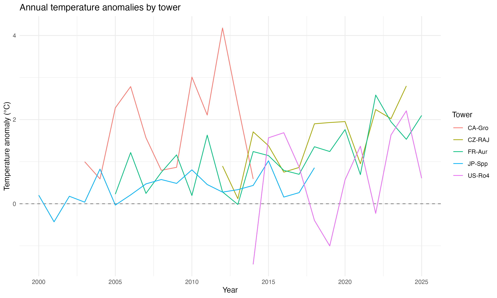
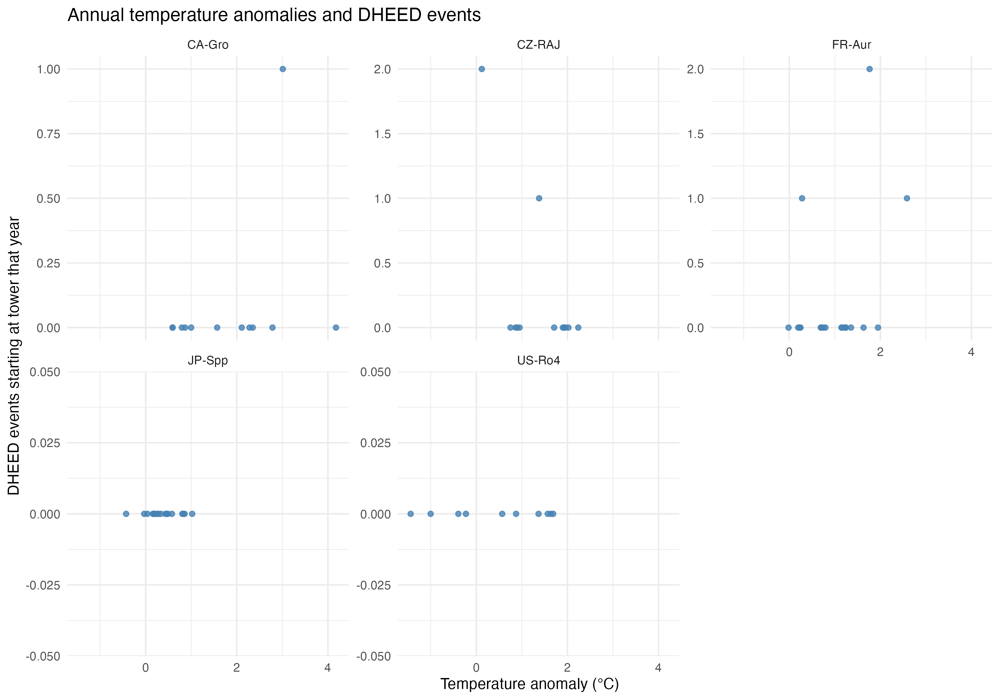

GitHub: [kczak99/datascience_env_monit](https://github.com/kczak99/datascience_env_monit)

# Question and Hypotheses

A. Temperature anomalies: Does each tower's yearly mean temperature differ from the WorldClim 1970–2000 normal?

B. Extreme events: Do temperature anomalies correspond to Dheed extreme events?

## Hypothesis

Towers with a higher temperature anomaly also tend to have more Dheed extreme days.

# Data

```{=html}
<style>
.table-scroll {
  overflow-x: auto;
  max-width: 100%;
}

.table-scroll table {
  min-width: 1500px;
  table-layout: fixed;
}

.table-scroll th:nth-child(1),
.table-scroll td:nth-child(1) { width: 130px; }
.table-scroll th:nth-child(2),
.table-scroll td:nth-child(2) { width: 230px; }
.table-scroll th:nth-child(3),
.table-scroll td:nth-child(3) { width: 135px; }
.table-scroll th:nth-child(4),
.table-scroll td:nth-child(4) { width: 210px; }
.table-scroll th:nth-child(5),
.table-scroll td:nth-child(5) { width: 130px; }
.table-scroll th:nth-child(6),
.table-scroll td:nth-child(6) { width: 160px; }
.table-scroll th:nth-child(7),
.table-scroll td:nth-child(7) {
  width: 650px;
  overflow-wrap: anywhere;
}
</style>
```

::: table-scroll
| Dataset | Variables used | Spatial resolution | Temporal resolution | Downloaded on | Script | Citation |
|-----------|-----------|-----------|-----------|-----------|-----------|-----------|
| FLUXNET | TA_F | per tower | Half-hourly observations, summarized yearly | 20.11.2026 | [get_my_towers.R](../scripts/get_my_towers.R) | For each tower's data product see [CITATIONS.txt](../data/raw/CITATIONS.txt) and Pastorello et al. (2020), *Scientific Data*, 7, 225. [doi:10.1038/s41597-020-0534-3](https://doi.org/10.1038/s41597-020-0534-3). |
| WorldClim 2.1 | Monthly `tavg` normals, averaged to annual BIO1-equivalent | 5 arc-minutes | 1970–2000 climatological normal | 20.11.2026 | [02_worldclim.R](../scripts/block5/02_worldclim.R) | Fick, S. E. & Hijmans, R. J. (2017). WorldClim 2: new 1-km spatial resolution climate surfaces for global land areas. *International Journal of Climatology*, 37, 4302–4315. [doi:10.1002/joc.5086](https://doi.org/10.1002/joc.5086). |
| DHEED | Events reaching each tower; annual count by first day at tower | 0.25° | Daily events, 1950–2023 | 20.11.2026 | [03_dheed.R](../scripts/block5/03_dheed.R) | Weynants, M. et al. (2025). Dheed: an ERA5 based global database of compound dry and hot extreme events from 1950 to 2023. *Earth System Science Data*, 17, 6621. [doi:10.5194/essd-17-6621-2025](https://doi.org/10.5194/essd-17-6621-2025). Data: [doi:10.5281/zenodo.14884254](https://doi.org/10.5281/zenodo.14884254). |
:::

External datasets used for the analysis

# Methods

## Analysis script

The analysis script can be found in [block5_mywork.R](/scripts/block5_mywork.R)

```{r}
#| echo: false
#| results: asis
script_paths <- c(
  file.path("scripts", "block5_mywork.R"),
  file.path("..", "..", "scripts", "block5_mywork.R")
)
script_path <- script_paths[file.exists(script_paths)][1]
if (is.na(script_path)) {
  stop("Could not find scripts/block5_mywork.R from the report directory.")
}
script_code <- readLines(script_path, warn = FALSE)
script_code <- gsub("&", "&amp;", script_code, fixed = TRUE)
script_code <- gsub("<", "&lt;", script_code, fixed = TRUE)
script_code <- gsub(">", "&gt;", script_code, fixed = TRUE)
cat(
  "<details><summary>Show analysis script</summary><pre><code class=\"language-r\">",
  paste(script_code, collapse = "\n"),
  "</code></pre></details>\n",
  sep = ""
)
```

# Results

The towers showed substantial differences in their mean annual temperature anomalies relative to the 1970–2000 WorldClim normal (Figure 1). CA-Gro had the largest mean anomaly (+1.84°C), reaching +4.18°C in 2012, whereas CZ-RAJ had a mean anomaly of +1.50°C and FR-Aur +1.08°C. JP-Spp had a smaller positive mean anomaly (+0.38°C), although negative anomalies occurred in several early years. US-Ro4 was the only tower without a clearly positive mean anomaly (+0.62°C; 95% CI: −0.12 to +1.36°C).

One-sample *t*-tests showed that the mean anomalies were significantly greater than zero at CA-Gro (*p* = 0.00016, Holm-adjusted *p* = 0.00047), CZ-RAJ (*p* = 0.0000099, Holm-adjusted *p* = 0.000039), FR-Aur (*p* = 0.00000065, Holm-adjusted *p* = 0.0000033), and JP-Spp (*p* = 0.00019, Holm-adjusted *p* = 0.00047). US-Ro4 did not differ significantly from zero (*p* = 0.091, Holm-adjusted *p* = 0.091).

{#fig-anomalies fig-alt="Line chart of annual temperature anomalies by tower from 2000 to 2025"}

Spearman correlations provided no consistent evidence that higher temperature anomalies were associated with more DHEED events (Figure 2). The correlations were positive and weak at CA-Gro (*ρ* = 0.393, *p* = 0.206) and FR-Aur (*ρ* = 0.303, *p* = 0.208), but negative and weak at CZ-RAJ (*ρ* = −0.414, *p* = 0.181). None was significant after Holm correction (all adjusted *p* = 0.543). A correlation could not be tested for JP-Spp or US-Ro4 because no extreme events occurred during the measurement periods.

{#fig-dheed fig-alt="Scatter plots of temperature anomaly and DHEED event count, faceted by tower"}

# Discussion

CA-Gro, CZ-RAJ, FR-Aur, and JP-Spp had yearly mean temperatures significantly above their WorldClim 1970–2000 normals. This pattern is broadly consistent with recent global warming. US-Ro4 did not have a mean anomaly significantly different from zero. Its later values were generally positive, but the available record did not test for a temporal trend; a positive trend in the future can therefore only be considered a hypothesis, not a result.

No DHEED correlation was statistically significant after Holm correction. CA-Gro and FR-Aur showed positive, weak correlations, whereas CZ-RAJ showed a negative, weak correlation. Thus, the positive correlation expected by the hypothesis was observed in two towers, but only without statistical support, and the opposite direction occurred at one tower. JP-Spp and US-Ro4 could not be tested because no DHEED event was recorded during their FLUXNET measurement periods. These small and inconsistent associations do not establish a relationship between annual temperature anomalies and DHEED events.

With more time or data, this analysis should use longer, overlapping site records, count DHEED events within an area-weighted buffer around each tower, and test event thresholds or alternative extreme-event definitions. It would also benefit from a formal trend test and a sensitivity analysis comparing FLUXNET annual means with daily or monthly tower anomalies.

# Data and Citations

## FLUXNET tower data

-   Kitamura, K., Mizoguchi, Y. (2026). *Fluxnet Archive Product from Sapporo Forest Meteorology Research Site, 2000–2018*. FLUXNET. <https://hdl.handle.net/11676/js_dXPMf2Ctz9mN3PGXCd2zb>
-   Czerný, R., Kowalska, N., Pavelka, M., Šigut, L. (2026). *Fluxnet Archive Product from Rajec, 2012–2024*. FLUXNET. <https://hdl.handle.net/11676/LlmTy3u9548FEMXEW59RiWpY>
-   McCaughey, Harry (2025). *AmeriFlux FLUXNET-1F CA-Gro Ontario - Groundhog River, Boreal Mixedwood Forest, Ver. v1.3_r1 (2003-2014)*. AmeriFlux AMP. <https://doi.org/10.17190/AMF/1902823>
-   Baker, John, and Tim Griffis (2026). *AmeriFlux FLUXNET-1F US-Ro4 Rosemount Prairie, Ver. v1.3_r1 (2014-2025)*. AmeriFlux AMP. <https://doi.org/10.17190/AMF/1881589>
-   Tallec, T., Ceschia, E., Granouillac, F., Claverie, N., Zawilski, B., Brut, A., Lemaire, B., Gibrin, H. (2026). *Fluxnet Archive Product from Aurade, 2005–2025*. FLUXNET. <https://hdl.handle.net/11676/e9BJpil-VqESMF4Y5NacyLVf>

Pastorello, G., Trotta, C., Canfora, E., et al. (2020). The FLUXNET2015 dataset and the ONEFlux processing pipeline for eddy covariance data. *Scientific Data*, 7, 225. <https://doi.org/10.1038/s41597-020-0534-3>

## WorldClim

Fick, S. E., and R. J. Hijmans (2017). WorldClim 2: new 1-km spatial resolution climate surfaces for global land areas. *International Journal of Climatology*, 37, 4302–4315. <https://doi.org/10.1002/joc.5086>

## DHEED

Weynants, M., et al. (2025). Dheed: an ERA5 based global database of compound dry and hot extreme events from 1950 to 2023. *Earth System Science Data*, 17, 6621. <https://doi.org/10.5194/essd-17-6621-2025>. Data available at <https://doi.org/10.5281/zenodo.14884254>.

## FLUXNET acknowledgement

> FLUXNET data products were produced and harmonized by eddy covariance regional networks and data processing centers, including AmeriFlux, ChinaFlux, European Fluxes Database, ICOS, JapanFlux, KoFlux, OzFlux, SAEON, and TERN. These products also include a modified version of ERA5 hourly data provided by the Copernicus Climate Change Service.